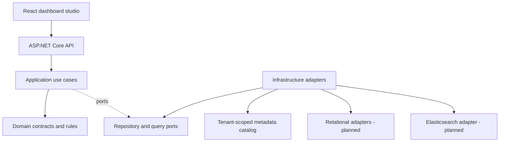

# Architecture and dependency boundaries

## Product intent

Analytics Dashboard is an independent analytics experience for software vendors incorporating dashboards into customer-facing applications. Each customer organization has independently authenticated users, connections, dashboard definitions, authorization, audit events, and resource limits.

The foundation implements dashboard definition and demonstration visualization workflows. Issue #4 adds tenant-owned data-source registration metadata. Live connectors are planned.

## Logical components

Domain and Application have no database or UI package dependencies. Infrastructure implements persistence contracts, while API composes adapters and validates identity at the boundary.

## Core concepts

| Concept | Purpose | Current state |
| --- | --- | --- |
| Organization | Tenant security and ownership boundary | Implemented |
| Membership | Links identity to organization and role | Implemented; demo seeded |
| Dashboard | Organization-owned, revisioned collection of widgets | Implemented |
| Widget | Chart kind, dataset, metric and dimension | Implemented for sample data |
| Data-source registration | Tenant-owned provider/name definition with revisions and provenance, but no connection configuration | Implemented in SQLite/API/UI; no connectivity |
| Connection | Secured network and authentication configuration | Not modeled or implemented |
| Query definition | Restricted, provider-neutral query contract | Planned |
| Data access policy | Connection permissions, quotas and timeouts | Planned |
| Audit event | Recorded identity, action, resource and outcome | Planned |

## Tenant isolation

- Never trust an organization identifier just because the browser supplied it.
- Resolve the user from validated server-side identity claims.
- Check membership and the required role on every organization-scoped operation.
- Include `organization_id` in all dashboard and data-source database predicates, including updates and deletes; constrain data-source updates **and deletions** with the expected revision.
- Never expose another organization's resources when a caller guesses identifiers.
- A dashboard link is a *pointer*, not an authorization grant.
- A future embed token must bind organization, subject, scopes and short expiration.

## Registration-only vertical slice

`DataSourceService` owns application authorization and registration rules. `IDataSourceRepository` is the application storage port. `SqliteDataSourceRepository` is a separate infrastructure adapter with organization-scoped, parameterized SQLite statements. It initializes an additive `data_source_definitions` table; it does not modify existing dashboard metadata.

Definitions have immutable IDs, organization, provider, creator and creation time. Only their display names can change; revisions and update timestamps advance on successful writes. `UPDATE` and `DELETE` use compare-and-swap revision predicates, so stale browser sessions cannot silently overwrite or remove newer registrations. Owner/editor mutations and member reads are authorized by server-side membership lookup before accessing the repository. Unauthorized tenant requests fail without disclosing whether a guessed definition exists.

HTTP requests deliberately have narrow shapes: `DataSourceDraft` accepts only name/provider and `DataSourceUpdate` only name/expected revision. Unknown JSON properties fail deserialization, enum providers are serialized as strings, and unexpected or numeric providers are rejected. No network endpoints, connection configurations, credential fields, connection tests, or query execution exist in this slice. Free-form display names are not an appropriate place for secrets.

## Connector architecture (future)

Providers will implement a shared query port while retaining provider-specific capabilities. SQL Server, MySQL, PostgreSQL, and SQLite will use supported ADO.NET providers. Elasticsearch will use its supported HTTP API and a constrained query DSL.

Required query properties:

1. Allowlisted dataset and schema binding, projection, aggregation and supported operators.
2. Tenant-scoped connections and read-only database credentials as an independent safeguard.
3. Parameterized predicates, ordering and deterministic row limits.
4. Time, connection, result-byte and concurrent-query budgets.
5. TLS validation and network egress/SSRF controls; data-source credentials stay server-side.
6. Adapter conformance tests against real provider instances, including timezone and type semantics.

A string prefix check for `SELECT` is **not** a security boundary against data modification. Use query structure, database permissions and provider-native controls together.

## Enterprise extension points

Separated identity, application, and infrastructure boundaries accommodate OIDC federation, provisioning, audit logs, quotas, background queries, observability, branding, and embedding without changing domain contracts.

## Compatibility and delivery

The backend uses .NET 10 LTS. The UI uses lockfile-controlled npm dependencies. Local/CI verification shares a PowerShell script. Each substantive capability has one reviewable issue/PR pair and a squash merge after owner approval.
