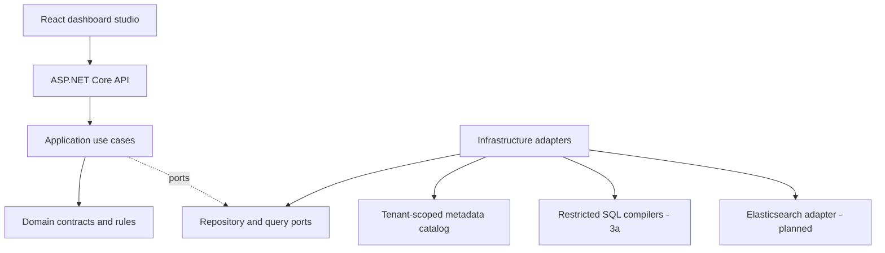

# Architecture and dependency boundaries

## Product intent

Analytics Dashboard is an independent analytics experience for software vendors incorporating dashboards into customer-facing applications. Each customer organization has independently authenticated users, connections, dashboard definitions, authorization, audit events, and resource limits.

The foundation implements dashboard definition and demonstration visualization workflows. Issue #4 adds tenant-owned data-source registration metadata; Issue #8 adds non-executing query contract validation. Issue #10 adds protected connection profiles and lifecycle operations without connecting to providers. Roadmap 3a (Issue #12) adds inert SQL Server/PostgreSQL query compilation and native command-binding conformance tests against disposable provider instances, without production execution. Live customer connectors remain planned.

## Logical components

Domain and Application have no database or UI package dependencies. Infrastructure implements persistence contracts, while API composes adapters and validates identity at the boundary.

## Core concepts

| Concept | Purpose | Current state |
| --- | --- | --- |
| Organization | Tenant security and ownership boundary | Implemented |
| Membership | Links identity to organization and role | Implemented; demo seeded |
| Dashboard | Organization-owned, revisioned collection of widgets | Implemented |
| Widget | Chart kind, dataset, metric and dimension | Implemented for sample data |
| Data-source registration | Tenant-owned provider/name definition with revisions and provenance, but no connection configuration | Implemented in SQLite/API/UI; no connectivity |
| Connection | Secured configuration, credential envelopes and lifecycle | Implemented as **configuration only**; live connectivity unavailable |
| Query definition | Restricted, provider-neutral contract and tenant-scoped validation against a trusted allowlist | Implemented in Issue #8; deployed allowlist empty, no execution |
| Relational query compilation | SQL Server/PostgreSQL typed SELECT synthesis and native command parameter binding | Implemented for test-bound inert plans in Issue #12; no app/API integration or live customer connections |
| Data access policy | Connection permissions, quotas and timeouts | Planned |
| Audit event | Recorded identity, action, resource and outcome | Connection mutation successes transactionally persisted; broader auditing planned |

## Tenant isolation

- Never trust an organization identifier just because the browser supplied it.
- Resolve the user from validated server-side identity claims.
- Check membership and the required role on every organization-scoped operation.
- Include `organization_id` in all dashboard and data-source database predicates, including updates and deletes; constrain data-source updates **and deletions** with the expected revision.
- A data-source registration that has a protected connection profile or revocation tombstone can only be deleted by an owner. An editor may delete an unconfigured registration; the storage DELETE predicate atomically verifies it remains unconfigured, preventing a race with credential creation.
- Never expose another organization's resources when a caller guesses identifiers.
- A dashboard link is a *pointer*, not an authorization grant.
- A future embed token must bind organization, subject, scopes and short expiration.

## Registration-only vertical slice

`DataSourceService` owns application authorization and registration rules. `IDataSourceRepository` is the application storage port. `SqliteDataSourceRepository` is a separate infrastructure adapter with organization-scoped, parameterized SQLite statements. It initializes an additive `data_source_definitions` table; it does not modify existing dashboard metadata.

Definitions have immutable IDs, organization, provider, creator and creation time. Only their display names can change; revisions and update timestamps advance on successful writes. `UPDATE` and `DELETE` use compare-and-swap revision predicates, so stale browser sessions cannot silently overwrite or remove newer registrations. Owner/editor mutations and member reads are authorized by server-side membership lookup before accessing the repository. Unauthorized tenant requests fail without disclosing whether a guessed definition exists.

HTTP requests deliberately have narrow shapes: `DataSourceDraft` accepts only name/provider and `DataSourceUpdate` only name/expected revision. Unknown JSON properties fail deserialization, enum providers are serialized as strings, and unexpected or numeric providers are rejected. No network endpoints, connection configurations, credential fields, connection tests, or query execution exist in this slice. Free-form display names are not an appropriate place for secrets.

## Query contract validation (Issue #8)

`QueryService` implements membership check → tenant-scoped registration lookup → trusted
`IQueryDatasetCatalog` allowlist → typed operator/aggregation/capability validation and
budget calculation. The deployed `UnconfiguredQueryDatasetCatalog` deliberately denies
all datasets. `/queries/validate` exposes only schema and limits, never records.
The validation route itself performs no schema inspection, credential access,
SQL compilation or query execution; the disconnected 3a compilers are not wired
into that route.
See [query contracts](query-contracts.md) for the type/operator matrix and limits.

## Connection security (Issue #10)

`ConnectionService` requires an organization **owner** through `IOrganizationCatalog`,
then resolves the registered data source using the existing tenant-scoped repository.
The HTTP input is distinct from registration and query inputs. Provider-specific
network configuration or server-mapped SQLite file identifiers are validated by
application ports implemented in infrastructure. Connection-profile revisions
are independent of registration-definition revisions.

`IConnectionRepository` stores encrypted secret envelopes, source-bound non-secret
configuration and transactional successful-mutation audit records. A successful
operation cannot commit without its audit event. `IConnectionSecretProtector` is
independent of the selected infrastructure cryptographic/key-management adapter.
`IConnectionCredentialReader` is server-side-only and has no HTTP route; future
query execution must enforce user query permission **before** trusted adapters
can request any credential. Secret envelopes are authenticated against tenant ID,
source ID and provider to prevent cross-context substitution.

`IConnectionDestinationPolicy` and `IDnsResolver` provide preliminary hostname,
exact allowlist and public-IP verification. `ApprovedNetworkDestination` carries
the vetted IP set and original hostname for *future* socket-bound enforcement.
The approved result is transient; configuration persistence is never authority
to connect. Connect-time DNS and destination enforcement, TLS verification and
egress policy remain mandatory adapter prerequisites. SQLite profile storage
contains an operator-defined logical file ID, not a customer-controlled path.

No new data query execution, active credential usage, schema inspection, network
socket, or filesystem customer database access is introduced. The trusted query
dataset catalog still denies all datasets by default. Full details and remaining
runtime controls: [connection security](connection-security.md).

## Connector architecture (3a and future)

Roadmap 3a provides SQL Server and PostgreSQL **compiler-only** infrastructure adapters and native command factories. `QueryShapeValidator` is shared between the authorization-first validation service and the compiler, which checks typed shape and trusted metadata again before producing a plan. The physical schema/table and stable unique ordering key come only from an operator-supplied `RelationalDatasetBinding`, never a request. Compiled SQL and native commands are not connected to the API, connection profiles or production execution. No new application execution port is enabled; that port will be defined after runtime authorization and transport boundaries are ready. See [relational adapter conformance](relational-adapters.md).

Future providers will implement a shared execution port while retaining provider-specific capabilities. Capability declarations remain conservative until relevant adapter conformance tests succeed. SQL Server and PostgreSQL compilers use supported ADO.NET providers in isolated tests; future MySQL and SQLite runtime adapters will use supported ADO.NET providers. Elasticsearch will use its supported HTTP API and a constrained query DSL.

Required query properties:

1. Allowlisted dataset and schema binding, projection, aggregation and supported operators.
2. Tenant-scoped connections and read-only database credentials as an independent safeguard.
3. Parameterized predicates, ordering and deterministic row limits.
4. Time, connection, result-byte and concurrent-query budgets.
5. TLS validation and network egress/SSRF controls; data-source credentials stay server-side.
6. Adapter conformance tests against real provider instances, including timezone and type semantics.

A string prefix check for `SELECT` is **not** a security boundary against data modification. Use query structure, database permissions and provider-native controls together.

## Enterprise extension points

Separated identity, application, and infrastructure boundaries accommodate OIDC federation, provisioning, audit logs, quotas, background queries, observability, branding, and embedding without changing domain contracts.

## Compatibility and delivery

The backend uses .NET 10 LTS. The UI uses lockfile-controlled npm dependencies. Local/CI verification shares a PowerShell script. Each substantive capability has one reviewable issue/PR pair and an authorized squash merge after verified reviews and checks.
